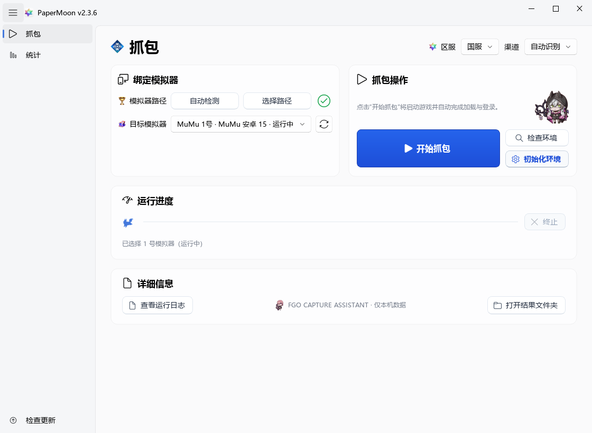
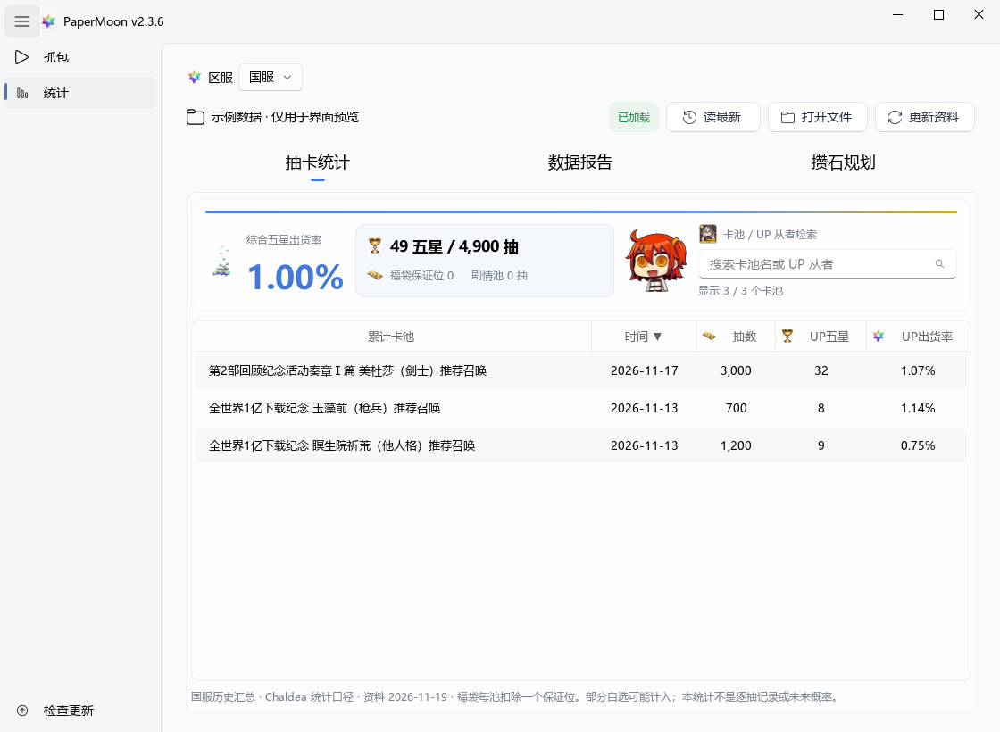
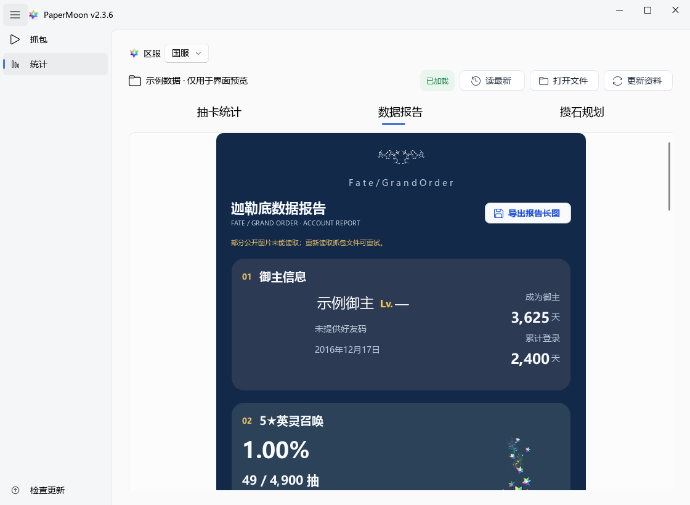
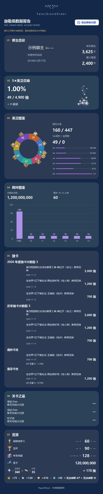
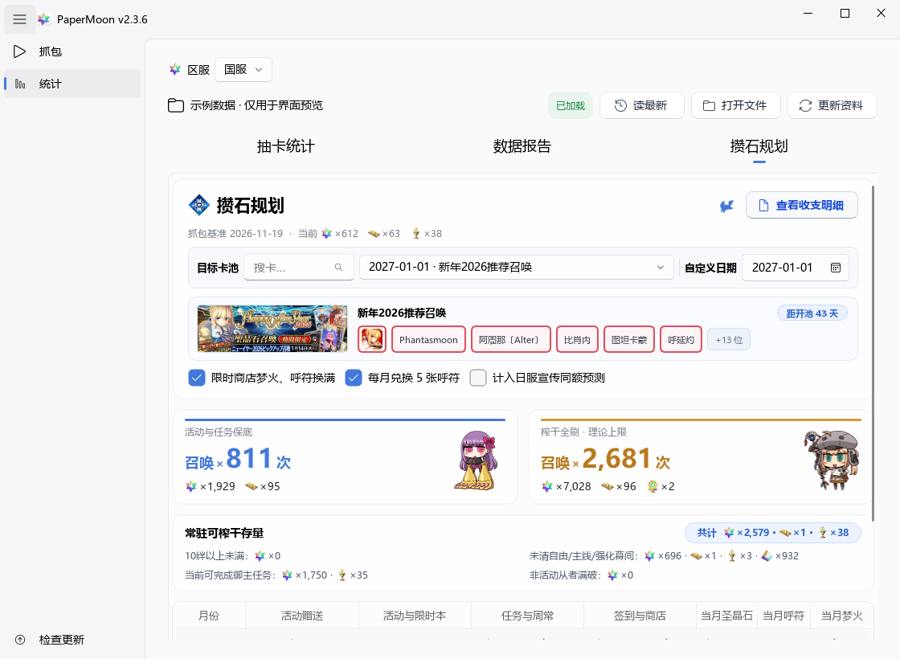

# FGO抓包助手 v2.3.8 · PaperMoon

<p align="center">
  
</p>

<p align="center">
  <strong>Windows 上的 FGO 抓包工具：抓一份完整登录响应，看抽卡统计、导出数据报告、算攒石规划，导出文件能直接导入 Chaldea。</strong>
</p>

<p align="center">
  
  
  
  
</p>

<p align="center">
  <a href="https://github.com/L-Molish/PaperMoon-FGOHelper/releases/download/v2.3.8/FGO.exe">下载</a>
  ·
  <a href="https://github.com/L-Molish/PaperMoon-FGOHelper/releases/download/v2.3.8/instructions.txt">使用说明</a>
  ·
  <a href="https://github.com/L-Molish/PaperMoon-FGOHelper/releases/download/v2.3.8/SHA256SUMS.txt">文件校验</a>
</p>

## 目录

- [这是什么](#这是什么)
  - [抓包：一次点击拿完整登录响应](#抓包一次点击拿完整登录响应)
  - [统计：抽数与出货率](#统计抽数与出货率)
  - [数据报告：一张长图看懂账号](#数据报告一张长图看懂账号)
  - [攒石规划：看到未来一年该攒多少](#攒石规划看到未来一年该攒多少)
- [支持范围](#支持范围)
  - [已实测](#已实测)
  - [不支持](#不支持)
- [快速开始](#快速开始)
- [常见问题](#常见问题)
- [更新日志](#更新日志)
- [隐私与数据](#隐私与数据)
- [从源码运行](#从源码运行)

## 这是什么

**PaperMoon**（ペーパームーン / 纸月）是 Windows 上的单文件程序。名字取自型月里那台虚数观测装置——它把高维的世界压到一张平面上、统一坐标轴；这个程序做的事也差不多，把游戏里的账目摊平了看清。

不用装 Python，也不用装 Reqable，下载下来双击就能跑。四个功能：**抓包**、**统计**、**数据报告**、**攒石规划**。

### 抓包：一次点击拿完整登录响应

模拟器的 ROOT 权限、CA 证书安装和网络代理都由程序处理，你只需要点一次开始。

<p align="center">
  
</p>

- **原样保存**：直接存服务器返回的完整正文，不裁字段、不重编实例编号、不重新序列化 JSON。磁盘文件和剪贴板是同一份（国服存 `results/CN/`，日服存 `results/JP/`）。
- **能直接喂 Chaldea**：国服正文是 URL 转义的 Base64，日服一般是 JSON —— 程序和你常用的 [Chaldea](https://github.com/chalda-center/chaldea) 都能直接读，不用自己解码。
- **自动点过标题画面**：用 Windows 自带的文字识别确认游戏停在哪个画面，自动点「请点击游戏界面」和标题登录；日服的日文加载提示改用固定文字图样比对，不需要另装日文 OCR。识别用的截图用完就删，不写进结果目录。
- **这些得你自己来**：首次账号登录、验证码、用户协议确认，程序不会代你填，也不会留存任何凭证。

### 统计：抽数与出货率

从登录数据里的召唤记录算出每个卡池的抽数、五星数和实际出货率。

<p align="center">
  
</p>

- **口径与 Chaldea 一致**：福袋每个池扣掉一个保底位之后再算五星率，和 Chaldea 的算法对齐。
- **数的是历史获得**：五星数按账号历史获得总数算，不是现在背包里还剩多少。
- **算不准就不显示**：卡池数据缺失，或图鉴里有随包资料还没收录的新从者时，整项显示为 `--` 而不是给个错数字；点「更新资料」拉到最新图鉴后会恢复正常。
- **按卡池看**：每个卡池的历史总抽数、五星数量、UP 从者出货率都能单独翻。

### 数据报告：一张长图看懂账号

把账号资料、图鉴、羁绊、抽卡和资源整理成一张长图，可以直接导出 PNG。

<p align="center">
  
</p>

- **一页看完**：御主资料、五星召唤、职阶分布图、羁绊分布、抽卡走势、关卡之最（自由本 / 活动本 / 击退战各自的最高通关次数）、圣晶石与素材库存。
- **导出长图**：整页报告可以导出成 PNG 长图，适合本地存档或者贴给别人看。

<p align="center">
  
</p>

### 攒石规划：看到未来一年该攒多少

用你的国服登录数据，加上未来的卡池排期，算到目标卡池那天手里能有多少抽。

<p align="center">
  
</p>

- **两种口径**：既算「开池当天手里有多少抽」，也算「把梦火全部刷完之后能有多少抽」。
- **全量收益精细核算**：自动纳入活动签到、关卡首通奖励、御主任务与活动任务、限时商店、每月 3 金方块换梦火、累计登录天数奖励，以及从者最终再临的圣晶石。
- **找卡池**：卡池名用 Mooncell 的命名，可以按关键词模糊搜（也认常用外号）；选中后显示卡池横幅和 UP 从者头像，期间限定红框、剧情限定蓝框。
- **前提要看清楚**：未来国服档期是按日服历史进度平移一年推出来的，**不是国服官方公告**。资料目前覆盖到 2027-11-18，点「更新资料」会往前滚。

## 支持范围

### 已实测

| 模拟器 | 国服 | 日服 | 台服 |
| --- | --- | --- | --- |
| MuMu 安卓 12 ROOT | ✅ 已实测（普通网络 / FlClash / biubiu） | — | ✅ 已实测（普通网络，无需加速器） |
| MuMu 安卓 15 ROOT | ✅ 已实测（含重启后自动恢复证书） | ✅ 保持原有支持，本轮未重测 | — |
| 雷电 14（安卓 14）ROOT | ✅ 已实测（普通网络 / FlClash / biubiu） | ✅ 已实测普通网络（加速器待测） | — |
| 雷电 9（安卓 9）ROOT | ✅ 已实测（普通网络 / FlClash / biubiu） | — | — |

**国服渠道服（已在 MuMu 安卓 12 上逐个实测）**：
- B服 / 享游 / iOS（同一安装包）
- 九游
- 小米
- vivo
- 4399
- 应用宝
- OPPO（v2.3.7 起）
- 华为（v2.3.7 起）

**台服（v2.3.7 起）**：小萌代理版本。实测**不需要加速器或代理**——台服流量走本机真实网络，程序按国服同样的直连流程抓取。首次启动会下载较多资源，耐心等游戏进入标题画面后开始抓包即可。

### 不支持

- **雷电同编号实例并发**：雷电 9 与雷电 14 的同编号实例请逐台运行，避免模拟器自身的 ADB 端口与编号发生冲突。
- **日服多设备引继**：日服同一账号引继到另一台设备后，原设备将无法继续登录，多设备测试请逐台引继。
- **日服 / 台服攒石规划**：攒石规划目前仅支持国服（需以国服完整登录响应为基准，并基于国服预测档期计算）。日服、台服账号可以正常抓包和看统计，但攒石页会提示不适用——没有对应区服的权威活动档期数据。

## 快速开始

1. **下载运行**：从 Releases 下 `FGO.exe`，放到一个**可写文件夹**里，双击就行（不用装 Python，不用装别的）。
2. **选择实例**：选国服还是日服，再选 MuMu 或雷电的实例。
3. **初始化与检查**：点「初始化环境」，完了再点「检查环境」—— 程序会自己开 ROOT、装证书并核验。
4. **开始抓包**：点「开始抓包」，助手会重启游戏、自动点过加载提示和标题画面；收到登录响应就停手并保存。
5. **看结果**：切到「统计」或「数据报告」点「读最新」；或者打开 [Chaldea](https://github.com/chalda-center/chaldea)，在「导入 → Https抓包」里选「从剪贴板导入」。

> [!NOTE]
> - **证书不用反复初始化**：证书是运行时挂载的，**不写安卓系统分区**。模拟器重启后直接点「开始抓包」，程序会自动重新挂载并核验。
> - **Windows 说「未知发布者」**：程序没买代码签名证书，属正常。可以拿 `SHA256SUMS.txt` 核一下哈希再点「仍要运行」。

## 常见问题

**Q: 运行程序时 Windows 提示「未知发布者」拦截怎么办？**  
A: 这个程序没有买代码签名证书，SmartScreen 看到没签名的 exe 就会拦。你可以拿发布页的 `SHA256SUMS.txt` 对一下 EXE 的哈希，确认没被改过之后点「更多信息」→「仍要运行」。

**Q: 环境检查未通过怎么办？**  
A: 主界面会逐项列出哪一项没过、为什么、该怎么处理（比如 ROOT 没开、端口被占）。照着改完再点一次「检查环境」。

**Q: 为什么模拟器重启后需要恢复证书？**  
A: 证书是运行时挂载进内存里的，程序不往只读的系统分区（`/system`）写任何东西。模拟器一重启，挂载自然就没了 —— 直接点「开始抓包」会自动重新挂载并核验，不用再点一遍「初始化环境」。

**Q: 抓包一直卡在「等待登录响应」怎么办？**  
A: 自动点击只管游戏启动后的「点击屏幕」和标题登录。碰上首次输入账号、滑块验证码、协议弹窗这类，程序会停下来等你手动处理完，然后继续抓。

**Q: 攒石规划里的卡池开放日期准确吗？**  
A: 不准。所有排期都是把日服同期进度往后推 365 天算的，**不是国服官方公告**。拿来规划资源没问题，具体开池时间还是以国服公告为准。

**Q: 统计页的五星出货率为什么显示为 `--`？**  
A: 图鉴里有随包资料还没收录的新从者。程序算不准就不给数，直接显示 `--`。点「更新资料」拉到最新图鉴就会恢复。

## 更新日志

- **v2.3.8 修复台服卡在标题页**：台服标题页的「Touch Screen」是英文艺术字，中文 OCR 读不出来，自动登录一直停在这一步。现在改用「固定位置 + 浅青蓝 + 画面闪烁」三重判定来识别，不再依赖 OCR。同时修掉三个渠道共用的两处问题：MuMu 加速服务弹窗挡住游戏、以及 `dumpsys window` 首行为 null 导致自动登录从不点击。
- **v2.3.7 支持 OPPO / 华为 / 台服**：国服渠道新增 OPPO 与华为（与其它渠道服同一抓包流程）；新增台服区服（小萌代理），实测无需加速器即可直连
- **v2.3.6 更名 PaperMoon**：程序名改为 PaperMoon，窗口标题、报告页脚与文件属性同步，图标重新矢量化
- **v2.3.5 修正 Q 版立绘标注与手动选目录：立绘其实是热情迷唇（Passionlip），标注与文件名已改正；手动选目录时选到中间层也能识别
- **v2.3.4 修正从者名显示：`メルトリリス` / `Meltryllis` 统一显示为官方译名「溶解莉莉丝」

更早的版本见 [Releases](https://github.com/L-Molish/PaperMoon-FGOHelper/releases)。

## 隐私与数据

- **别外传抓包文件**：完整响应里带着服务器返回的账号标识、签名等字段，**只在本地保管，不要发到公开网络上**。
- **只在本机算，不上传**：抓包解析、抽卡统计、报告生成、长图导出全部在本地完成，**不会把你的抓包文件和账号数据发到任何服务器**。
- **不多存**：不保存请求内容、不保存失败响应正文、不留额外的解码副本。
- **东西都在你自己机器上**：抓包文件（`results/`）、本机证书、代理设置都在程序目录里，你随时可以自己清理。

## 从源码运行

```powershell
# 依赖版本见 requirements-fluent.txt
.\.venv-fluent\Scripts\python.exe fgo_assistant.py

# 离屏运行测试
$env:QT_QPA_PLATFORM = 'offscreen'
.\.venv-fluent\Scripts\python.exe -m unittest discover -s tests -t .
```
